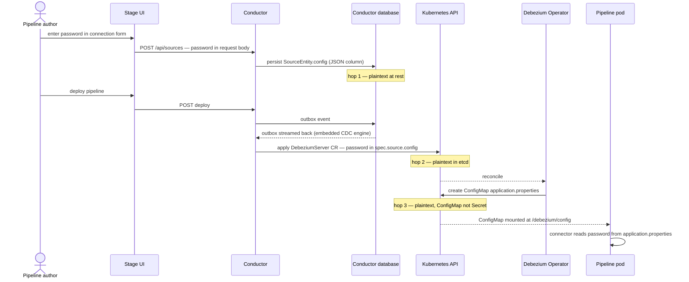
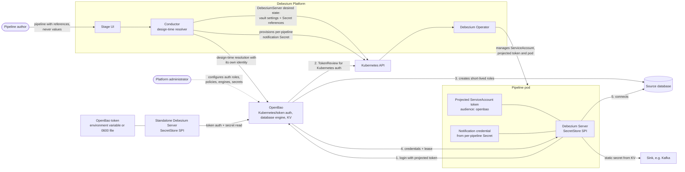
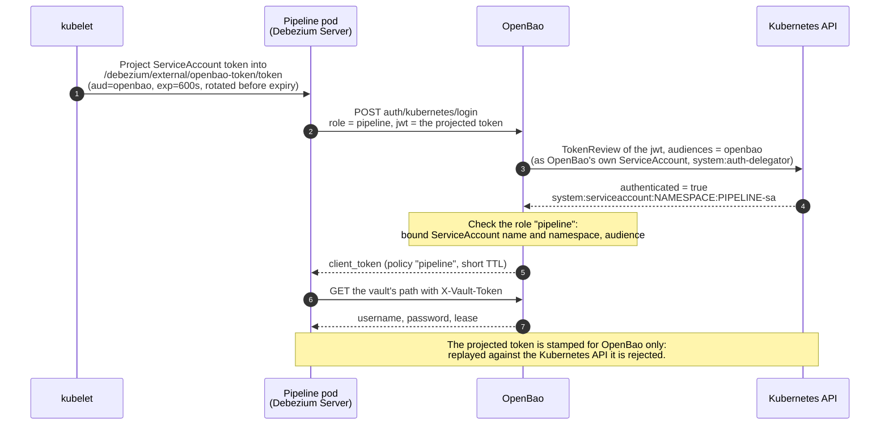
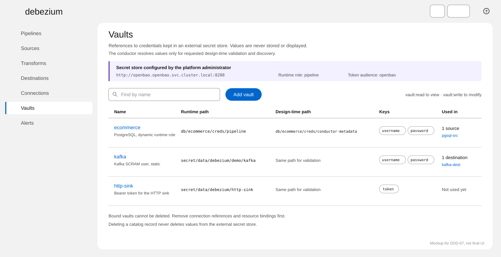
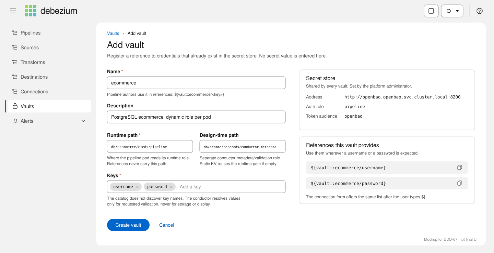
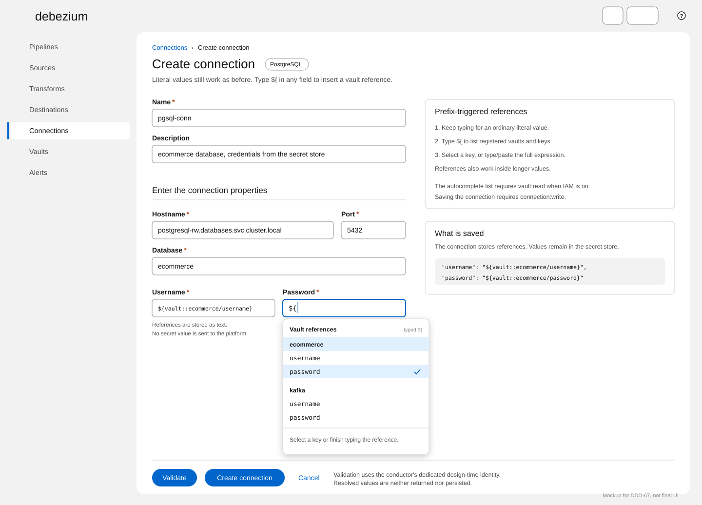
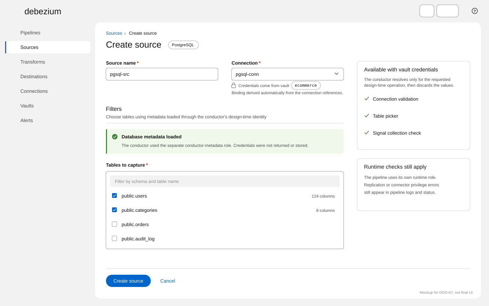
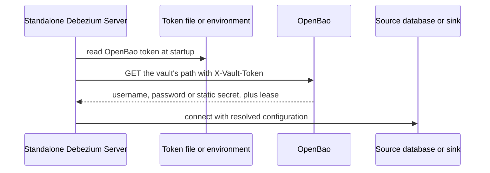

# DDD-67: Credentials Management for Debezium Platform

## Motivation

The Debezium Platform enables users to create and manage data pipelines through the Stage UI.
However, the platform currently does not provide a secure mechanism to store, rotate, and audit access to
secrets – passwords, API tokens, encryption keys, etc.
Credentials management is critical for security and compliance, and for production use.

As described in [Giovanni's blog post](https://debezium.io/blog/2026/09/17/debezium-server-native/), using Debezium
Server with the platform is not a pre-requisite. A standalone Debezium Server can also be used to manage credentials
separately from the platform. Where applicable, the document explains this use case.

## Current state

Secrets currently travel a plaintext path
through Debezium Platform:

1. Connector configuration — source, destination, transform, and connection — password included, is stored as a
   plain `Map` persisted to a JSON column in the conductor database
   (`SourceEntity.config`, `DestinationEntity.config`).
2. `PipelineMapper.createSource()` copies that config as-is into the
   `DebeziumServer` CR spec.
3. The operator renders the whole configuration into a **ConfigMap**
   (`application.properties`), not a Secret, mounted into the pipeline pod.



Every hop stores the credential in the clear. Read access to ConfigMaps is usually
granted far more widely than access to Secrets, and ConfigMaps are not guaranteed to have the same encryption-at-rest protection as Secrets.
Many clusters encrypt Secrets but not ConfigMaps. So if you put credentials in a ConfigMap,
those credentials may be stored with weaker protection and may be easier to leak.
ConfigMaps also often get included in troubleshooting exports, so any credentials
stored there may be accidentally shared.

The platform already includes the beginnings of a credentials mechanism, but it is not wired up: the `Vault`
entity has REST CRUD, persistence and outbox events on create/update/delete,
join tables binding it to sources, destinations, and transforms — but then the
watcher flow ends at a no-op (`OperatorVaultController.deploy()` is an empty
stub), `PipelineMapper` reads none of it, and the Stage UI never calls the
API. Even fully wired, today's entity models a secret _container_ (a plaintext
`Map`, `plaintext` boolean included), not a reference to an external store.

This approach also makes credential rotation difficult. The credentials are shared
secrets that tend to live for a long time. Tools like External Secrets Operator or
Vault Secrets Operator can update the secret value, but the usual way to make the
application pick up that change is to restart the Deployment.

For JDBC connectors, this is typically not a good fit. The connector holds a replication
slot and uses a `Recreate` deployment strategy, so each restart fully stops streaming
before starting it again. In practice, every credential rotation would cause an interruption in the data stream.

## Goals

- Provide a **reference implementation using [OpenBao](https://openbao.org/)**
  — open source (MPL-2.0, a Linux Foundation project), API-compatible with
  HashiCorp Vault.
- **Support other secret stores and workload identities** by design: stores
  (HashiCorp Vault, AWS Secrets Manager, Azure Key Vault, GCP Secret Manager)
  plug in behind the `SecretStore` SPI; identity verifiers that decorate the
  ServiceAccount rather than the pod (AWS IRSA, Azure Workload Identity, GCP
  Workload Identity Federation) are covered by bring-your-own ServiceAccount.
- Pipeline configuration carries **references, not values** — no user-managed credential is
  written to the conductor database, the `DebeziumServer` CR, or any
  ConfigMap. Because resolution operates on configuration properties, it is
  agnostic to what the secret is for: a JDBC database password, an API key for
  an external REST service invoked from a transform, a Kafka SASL password, an
  offset-store credential.
- The pipeline pod **fetches its own runtime credentials** from a secret store.
  On Kubernetes it authenticates with an audience-scoped projected ServiceAccount token;
  a standalone Debezium Server can instead use an OpenBao token supplied through an
  environment variable or a file.
- The **conductor has a dedicated identity for design-time operations**. It can resolve
  references transiently for connection validation and metadata discovery, using a separate,
  least-privilege database role for dynamic database credentials. Resolved values are never
  persisted, returned by the API, or logged.
- **Dynamic database credentials**: short-lived database roles are created for
  each pod by the secret store's database engine. Today, those roles are valid
  for the configured TTL. PostgreSQL only checks credentials when a connection
  is created, so existing connections can keep working until they are recreated.
  Lease renewal is not implemented yet, but this model provides the foundation
  for renewing credentials in the future, up to the configured maximum TTL.
- **Static secrets** (Kafka SASL passwords, HTTP tokens, …) resolved from KV
  storage through the same mechanism.
- The mechanism is **backend-agnostic**: an SPI with one implementation per
  secret store, starting with OpenBao.
- The per-pipeline notification credential introduced by
  [DDD-79](https://github.com/debezium/debezium-design-documents/pull/80) is also kept out of the
  `DebeziumServer` CR and ConfigMap, using a per-pipeline Kubernetes Secret reference.
- **Inert by default**: the Debezium Server, operator, and platform changes activate
  only when explicitly configured; existing deployments are untouched.

## Out of scope

- **Lease renewal.** Future work. The design leaves room for it, and it is straightforward for OpenBao with PostgreSQL.
- **Per-pipeline credential segregation for user-managed secrets.** The runtime trust boundary is
  the Debezium Platform instance: one pipeline auth role and one policy, so every
  pipeline pod holds the same secret-store permissions, and any principal with permission to
  create or edit the relevant resources can bind any registered credential reference. Pipelines within an
  instance are mutually trusted. Finer segregation is future work. Notification credentials use distinct
  per-pipeline Kubernetes Secrets; their mode-dependent runtime isolation is defined below.
- **Production installation of the secret store** (TLS, storage, unseal,
  backup). The reference implementation documents it; this design assumes a
  reachable, configured OpenBao.
- **Host-mode Debezium Platform.** This increment covers the platform and operator on Kubernetes and
  standalone Debezium Server on a host. A host-deployed conductor with agent-managed pipeline containers
  is not covered: token distribution, file permissions, renewal and revocation between conductor and agent
  require a separate design. Standalone Server token authentication does not by itself provide host-mode
  platform support.
- **Human SSO and the general platform permission system.** These are defined by
  [DDD-79](https://github.com/debezium/debezium-design-documents/pull/80). This document defines only
  the credentials-management permissions and UI behavior that integrate with it.
- **Platform user-action auditing.** OpenBao audit devices can record secret-store access by the
  conductor and pipeline identities. Recording which human principal performed each platform mutation
  is a DDD-79 concern and is not included here.
- **Infrastructure as Code** is out of scope for now. The implementation thus
  requires a human administrator to configure the secret store.

## Proposed Changes

### Overview



The design has three parts:

1. **Debezium Server** gains a secret-resolution Service Provider Interface. A configuration property
   carries a reference such as `${vault::ecommerce/password}`; a SmallRye
   `SecretKeysHandler` resolves it when the configuration is read — before any
   Kafka client, JDBC driver, notification channel, or sink sees it. The SPI is `SecretStore`, and
   `OpenBaoSecretStore` is the first implementation, with both Kubernetes and token authentication.
2. **The Debezium Operator owns pipeline workload identity in the target architecture.** The conductor
   maps bound vaults into the `DebeziumServer` CR; the operator creates or adopts the pipeline
   ServiceAccount, disables default token automount, mounts the audience-scoped projected token,
   and supplies vault coordinates and Secret-backed environment variables to the pod. This makes the
   feature available to operator-only deployments without requiring the platform conductor.
3. **The conductor uses its own, separate identity for design-time resolution** so validation and
   metadata discovery continue to work with vault-backed connections. It also provisions the
   per-pipeline notification credential into a Kubernetes Secret; it never writes user-managed
   credentials to OpenBao.

An initial end-to-end implementation may temporarily keep ServiceAccount and projected-token wiring in
the conductor while the operator CRD contract is being implemented. That is a transitional deployment
step only, not the target design. The operator contract is part of this design, not deferred work.

The platform's secret-store setup is performed by hand rather than provisioned as code, since Infrastructure as Code is out of scope for now.
It is a short, ordered list of commands an administrator runs and verifies — once per platform (authentication methods and policies),
once per database (mount, connection config, runtime and design-time role templates, root rotation),
and one `kv put` per static secret.

### Reference syntax and resolution (Debezium Server)

```properties
debezium.source.database.user=${vault::ecommerce/username}
debezium.source.database.password=${vault::ecommerce/password}
debezium.sink.kafka.producer.sasl.jaas.config=...password="${vault::kafka/password}";
```

The reference does not include a path on purpose. This prevents users from pointing
it at a different secret location, and makes the same pipeline definition easier to move between environments.

References are expanded even when embedded inside a larger value (the Kafka
JAAS line above), and resolution covers every user-managed secret property — source, sink, offset
storage, schema history, and transform configuration. This is the argument for resolving at the configuration layer
rather than per connector: some sensitive credentials are related to neither source nor sink.
The internally generated notification credential is the deliberate exception described below: it uses a
Kubernetes `secretKeyRef` rather than a user-visible vault reference.

Resolution is delegated to a small Service Provider Interface, so the handler knows nothing
about any particular store:

```java
public interface SecretStore extends AutoCloseable {

    /**
     * Reads every value held at {@code path}. Returning the whole set lets one read serve
     * several properties: a dynamic database credential arrives as a username and a password
     * together, and fetching them separately would mint two unrelated credentials.
     */
    Map<String, String> read(String path);

    @Override
    default void close() {
    }
}
```

A `${vault::<name>/<key>}` expression is parsed into a `VaultReference`. `VaultSecretKeysHandler`
looks up the named `Vault` (a name, a fixed path and a `SecretStore`), reads it once, caches the
whole map, and answers keys from it. `VaultSecretKeysHandlerFactory` builds the vaults from
`debezium.vault.<name>.*` properties. `OpenBaoSecretStore` is the first implementation and the
factory instantiates it directly today; how another implementation is selected is not designed yet.

### Authentication modes

Both authentication modes are first-class parts of the design. Kubernetes authentication is the default
for platform and operator deployments; token authentication enables the same `SecretStore` SPI on a
standalone host. Static tokens are not the recommended default for Kubernetes workloads, where a
projected ServiceAccount token avoids distributing a long-lived secret.

| Deployment | Authentication | Credential supplied by |
|---|---|---|
| Platform/operator on Kubernetes | `auth/kubernetes/login` | Audience-scoped projected ServiceAccount token |
| Conductor design-time operations | `auth/kubernetes/login` | Separate projected token for the conductor ServiceAccount |
| Standalone Debezium Server | Direct token authentication | OpenBao token from an environment variable or a `0600` file |

The selected method is part of each vault's `debezium.vault.<name>.*` configuration. For example:

```properties
debezium.vault.ecommerce.address=https://openbao.example.com:8200
debezium.vault.ecommerce.path=db/ecommerce/creds/pipeline
debezium.vault.ecommerce.auth-method=token
debezium.vault.ecommerce.auth-token-path=/run/secrets/openbao-token
```

With token authentication, `OpenBaoSecretStore` reads the token and sends it as `X-Vault-Token`; there is
no Kubernetes login or TokenReview. With Kubernetes authentication, it calls `auth/kubernetes/login`
first and uses the resulting short-lived OpenBao client token. Correspondingly, `_AUTH_TOKEN_PATH` follows
the selected method: in Kubernetes mode it points to the projected ServiceAccount JWT used for the OpenBao
login; in token mode it points directly to the OpenBao client token sent as `X-Vault-Token`.

### Pod identity and provisioning (Debezium Operator)

The following platform configuration enables vault integration and supplies the settings shared by every
pipeline vault:

```yaml
- name: PIPELINE_VAULT_ENABLED
  value: "true"
- name: PIPELINE_VAULT_AUDIENCE
  value: "openbao"
- name: PIPELINE_VAULT_AUTH_ROLE
  value: "pipeline"
- name: PIPELINE_VAULT_ADDRESS
  value: "http://openbao.openbao.svc.cluster.local:8200"
- name: PIPELINE_VAULT_VOLUME_NAME
  value: "openbao-token"
- name: PIPELINE_VAULT_TOKEN_EXPIRATION_SECONDS
  value: "600"
```

The conductor translates these shared settings and the pipeline's bound vaults into desired state on the
`DebeziumServer` CR. The operator-side contract is equivalent to:

```yaml
spec:
  vault:
    enabled: true
    serviceAccount:
      name: orders-sa # optional: adopt an existing ServiceAccount
    projectedToken:
      audience: openbao
      expirationSeconds: 600
    stores:
      - name: ecommerce
        address: http://openbao.openbao.svc.cluster.local:8200
        path: db/ecommerce/creds/pipeline
        authRole: pipeline
  notifications:
    authorizationSecretKeyRef:
      name: orders-notification
      key: authorization
```

The exact field names can follow operator CRD conventions, but the capabilities are part of the design:

- create a per-pipeline ServiceAccount when `serviceAccount.name` is absent, or adopt the named
  ServiceAccount for bring-your-own workload identity;
- set `automountServiceAccountToken: false` on operator-managed pipeline ServiceAccounts and require the
  same setting on an adopted ServiceAccount, rejecting a configuration that would leave the default
  Kubernetes API token in the pod;
- mount an audience-scoped projected token (`audience: openbao`) and rotate it before expiry;
- translate each configured store into `DEBEZIUM_VAULT_NAMES`, `_ADDRESS`, `_PATH`, `_AUTH_ROLE`,
  `_AUTH_METHOD`, and `_AUTH_TOKEN_PATH` environment variables;
- mount the notification authorization value through the `secretKeyRef` described below;
- reconcile these resources for operator-only users, without any conductor involvement.

For a Kubernetes `DebeziumServer` CR, the operator derives `_AUTH_METHOD=kubernetes` and sets
`_AUTH_TOKEN_PATH` to the projected-token mount path, so those values do not need to be duplicated in each
`stores` entry. Standalone token mode supplies its own token path directly in the Debezium Server configuration.

On the secret-store side, the administrator enables the Kubernetes auth method once and writes
separate policies for pipeline runtime access and conductor design-time access:

```shell
bao auth enable kubernetes
bao write auth/kubernetes/config kubernetes_host="https://kubernetes.default.svc:443"

bao policy write pipeline - <<'POLICY'
path "db/+/creds/pipeline"       { capabilities = ["read"] }
path "secret/data/debezium/*"    { capabilities = ["read"] }
path "sys/leases/renew"          { capabilities = ["update"] }
path "sys/leases/revoke"         { capabilities = ["update"] }
POLICY

bao policy write conductor - <<'POLICY'
path "db/+/creds/conductor-metadata" { capabilities = ["read"] }
path "secret/data/debezium/*"        { capabilities = ["read"] }
POLICY

bao write auth/kubernetes/role/pipeline \
  bound_service_account_names="*" \
  bound_service_account_namespaces="<pipeline-namespace>" \
  token_policies="pipeline" \
  audience="openbao"

bao write auth/kubernetes/role/conductor \
  bound_service_account_names="<conductor-service-account>" \
  bound_service_account_namespaces="<platform-namespace>" \
  token_policies="conductor" \
  audience="openbao"
```

The role bindings are load-bearing security constraints. The pipeline wildcard is limited to the explicit
pipeline namespaces for this increment. The conductor role must never use a wildcard: only the named
conductor ServiceAccount in the named platform namespace can obtain the conductor policy. A pipeline pod,
even in the same namespace, cannot log in as the conductor and must receive only the pipeline policy.

The conductor policy is illustrative: static KV validation requires transient read access to the static
secrets that the platform is allowed to validate. Dynamic database validation uses the separate
`conductor-metadata` role instead of the pipeline runtime role. The two `sys/leases` lines in the pipeline
policy are forward-looking. Nothing renews or revokes a lease yet (see Future Work); granting them now
means the policy does not have to change later.

The pipeline login is a three-party exchange: the pod presents its identity, OpenBao asks the
Kubernetes API whether that identity is genuine, and only then issues its own token.



`OpenBaoSecretStore` authenticates via `auth/kubernetes/login` with the
projected token, then reads the configured path. Response handling covers both
dynamic engines and KV v2 (values nested under `data.data` beside `data.metadata`).

The OpenBao audience must not be confused with the conductor OIDC audience from DDD-79:

- `pipeline.vault.audience` (`openbao` in the examples) scopes a ServiceAccount token to OpenBao.
- `quarkus.oidc.token.audience` identifies the conductor API in user and automation access tokens.

Both checks are mandatory in their respective flows, but they validate different tokens and must be
configured independently.

### Conductor design-time resolution

The conductor uses the chart's existing conductor ServiceAccount, which is distinct from every pipeline
ServiceAccount. The conductor Helm chart, not the Debezium Operator, adds a second, audience-scoped projected
token to that same ServiceAccount and pod for OpenBao. This is not a second conductor ServiceAccount or a
new Kubernetes API identity: the existing identity and its normal API credentials remain, while the additional
token and the exactly bound OpenBao role above provide a separate design-time identity toward OpenBao.
The operator manages only pipeline workload identity. The conductor uses its OpenBao identity only for:

- connection validation;
- database table and collection discovery;
- signal-collection checks;
- the incremental-snapshot table explorer.

For a dynamic database vault, the catalog's `designTimePath` points to a separate OpenBao database role,
`conductor-metadata` in the examples. Its creation statements grant only the privileges needed for
connection validation and metadata discovery, not replication or pipeline data writes. The pipeline uses
`path`, which points to the runtime role. Successful design-time discovery therefore does not replace
runtime error reporting: the runtime role still needs its own replication and connector privileges.

For a static KV vault, there is no separate metadata-only credential to mint. When a user explicitly asks
to validate a connection, the conductor reads the referenced static secret transiently using its own
identity. The value exists only for the duration of that operation. It is not cached after the request,
written to the conductor database or a Kubernetes resource, included in an API response, or logged.
Deployments that do not want the conductor to have this static-secret read capability can withhold that
policy and accept that the corresponding validation remains unavailable; database discovery still uses
the separate design-time role.

This design deliberately keeps runtime custody in the pipeline pod. The conductor never fetches a
user-managed credential and injects it into a pipeline resource.

### Notification callback credential

DDD-79 introduces a per-pipeline credential that Debezium Server sends in
`debezium.source.notification.http.authorization` when posting snapshot notifications to the conductor.
That credential must not appear in the `DebeziumServer` CR or the generated ConfigMap. This section is the
externalization hand-off named in DDD-79's prerequisites: it removes the interim CR exposure in the target
design rather than accepting it.

A user-managed OpenBao reference is not a good fit for this value: the conductor generates it, writing it
to OpenBao would require new secret-store write privileges, and the shared pipeline policy would not
preserve its per-pipeline isolation. Instead, the conductor provisions a dedicated Kubernetes Secret for
each pipeline:

```yaml
apiVersion: v1
kind: Secret
metadata:
  name: orders-notification
  labels:
    app.kubernetes.io/managed-by: debezium-conductor
  ownerReferences:
    - apiVersion: <DebeziumServer CR apiVersion>
      kind: DebeziumServer
      name: orders
      uid: <DebeziumServer CR UID>
      controller: true
type: Opaque
stringData:
  authorization: Bearer <per-pipeline-credential>
```

The `DebeziumServer` CR contains only `spec.notifications.authorizationSecretKeyRef`. The operator maps
that reference to a Secret-backed environment variable; it does not copy the value into
`application.properties`:

```yaml
env:
  - name: DEBEZIUM_SOURCE_NOTIFICATION_HTTP_AUTHORIZATION
    valueFrom:
      secretKeyRef:
        name: orders-notification
        key: authorization
```

SmallRye Config maps that environment variable to `debezium.source.notification.http.authorization`.
The conductor still verifies callbacks by recomputing the derived credential and stores nothing in its
database; the derived value exists only in the per-pipeline Kubernetes Secret and the pod that consumes it.

#### Secret RBAC and lifecycle

The conductor Helm Role needs a namespace-scoped rule for core `secrets` with `create`, `get`, `update`,
`patch`, and `delete`:

- `create`, `get`, `update`, and `patch` support idempotent provisioning and server-side apply;
- `delete` supports explicit cleanup when notification credentials are disabled or an orphan must be removed;
- deletion of the pipeline itself is handled by Kubernetes garbage collection, not by a conductor delete call.

The Secret's owner reference points to its `DebeziumServer` CR, so deleting the pipeline's CR also deletes
the notification Secret. The conductor must create or observe the CR first and use its UID when setting
the owner reference; creation ordering must not leave a new Secret without an owner after reconciliation
completes.

#### Runtime isolation

Each pipeline CR references a distinct Secret, and the operator mounts only that Secret into the pipeline
pod. The strength of the resulting runtime isolation depends on the pipeline ServiceAccount configuration:

- With `pipeline.vault.enabled: true`, the operator-managed or validated adopted ServiceAccount has default
  token automount disabled. The pod therefore cannot use the Kubernetes API to enumerate or read other
  pipelines' notification Secrets, even though the operator's current RBAC is too broad.
- With IAM enabled but vault integration disabled, the pipeline currently uses its operator-managed
  per-pipeline ServiceAccount with default API-token automount still enabled, and that identity can read
  every Secret in the namespace. The per-pipeline Secret still keeps the credential out of the CR and
  ConfigMap, but it does **not** protect other pipelines' Secrets from a compromised pod in this mode.
  Runtime isolation requires
  [debezium/dbz#2327](https://github.com/debezium/dbz/issues/2327), or an equivalent least-privilege
  ServiceAccount with no default API token in the pod.

Initial enablement follows the DDD-79 upgrade sequence:

1. Set `conductor.security.internal-credential.secret` while IAM enforcement remains disabled.
2. Regenerate every pipeline resource and roll every pod, using DDD-79's redeploy-all operation.
   The conductor creates or updates the per-pipeline Secrets and the operator mounts them.
3. Confirm every pipeline has rolled.
4. Enable `conductor.security.enabled`, once every callback carries a valid credential.

For rotation, configure `conductor.security.internal-credential.previous-secret` so the conductor accepts
both generations, update the per-pipeline Secrets, and redeploy all pipelines. Remove the previous secret
only after every pod runs the new credential. Secret updates do not restart pods automatically; until the
redeploy-all operation is available, an ordinary no-op pipeline update per pipeline is the fallback.

### Privilege separation

With vault integration enabled, the measured result for the pipeline pod is that its only
Kubernetes-issued token is the projected OpenBao one. It cannot call the Kubernetes API (`401`), and a
token stolen from the pod is only good for logging in to the secret store as the pipeline role. Runtime
database credentials remain self-fetched.

| Component | K8s API access | User-managed credential access |
|---|---|---|
| Conductor | yes — creates CRs and reconciles notification Secrets | transient design-time resolution only; no persistence or runtime injection |
| Operator | yes — reconciles | no value access required; mounts Secret and vault references |
| Pipeline pod with vault integration | **no** | yes — runtime, self-fetched |

Related: today the operator grants every pipeline ServiceAccount read access to all
Secrets and ConfigMaps in the namespace, including a ServiceAccount the platform supplies
([debezium/dbz#2327](https://github.com/debezium/dbz/issues/2327)). Vault integration turns off default
token automount, so the pod cannot use that access. With IAM alone, the default ServiceAccount token and
its broad Secret access remain. Implementing dbz#2327 is still needed to remove the excessive RBAC in
vault mode and to provide runtime Secret isolation in IAM-only mode.

### Conductor data model: the Vault entity as a reference catalog

The conductor already carries the schema for this design, but the `Vault` entity today models
a secret _container_; this design repurposes it as a **catalog of references** — records that point at
credentials whose values are never persisted by the platform.

The record changes shape as follows:

| Field | Today | Proposed |
|---|---|---|
| `id`, `name`, `description` | as is | unchanged; `name` is what a reference uses: `${vault::<name>/<key>}` |
| `plaintext` | boolean: the values are stored unencrypted | removed; the platform stores no values |
| `items` | `Map<String, String>` of secret values | `List<String>`; the key names the reference serves, no values |
| `path` | absent | new column: the runtime location in the secret store, e.g. `db/ecommerce/creds/pipeline` |
| `designTimePath` | absent | new nullable column: the separate metadata/validation role, e.g. `db/ecommerce/creds/conductor-metadata`; static KV entries can reuse `path` |
| store address, auth role | absent | not on the entity: platform-wide configuration (`pipeline.vault.address`, `pipeline.vault.authRole`), one store and one runtime role per platform instance |

Example of a proposed entity:

```json
{
  "id": 1,
  "name": "ecommerce",
  "description": "PostgreSQL ecommerce, dynamic role per pod",
  "path": "db/ecommerce/creds/pipeline",
  "designTimePath": "db/ecommerce/creds/conductor-metadata",
  "items": ["username", "password"]
}
```

The key names in `items` are `username` and `password` for a database mount. For a KV entry
the administrator types them in, since the conductor does not discover secret-store keys. One Flyway
migration covers the change: add `path` and `designTimePath`, drop `plaintext`, clear any stored values.
`designTimePath` is never emitted to the pipeline pod and never appears in a `${vault::…}` expression.

- **Registration:** Creating the vault record becomes the administrator's final
  per-database step: after configuring `db/ecommerce` in the secret store,
  they register the `ecommerce` reference in the UI. Secret-store
  configuration is the authorization decision; the vault record is its
  publication to platform users, and it is what the reference autocomplete in
  connection and other configuration forms lists.
- **Binding:** The initial conductor schema already creates the link tables
  `source_vault`, `destination_vault` and `transform_vault`
  (`V3.1.0__initial_database.sql`); no code reads them today. When one of those resources is saved,
  the conductor parses the `${vault::…}` references in its connection and component configuration and
  creates or updates the link rows automatically. Users never maintain a separate binding. A
  `source_vault` row linking a source to vault `ecommerce` tells
  `PipelineMapper`, when it builds the CR for a pipeline using that
  source, to emit that vault's runtime coordinates in the CR, so the operator can supply them to the pod and the
  `${vault::ecommerce/…}` references held by the connection can be resolved. The chart-level
  `pipeline.vault.*` values carry only what every vault shares: whether the
  feature is on, the store address, the runtime auth role and the projected-token
  settings. What differs per vault, its name and runtime path, comes from the derived row.

  Editing a connection's own configuration triggers the same derivation for every source, destination and
  transform that uses it. The conductor compares the old and new reference sets, adds and removes link rows
  as necessary, and regenerates and redeploys every affected pipeline through the normal update/outbox path.
  Binding updates and the connection edit must complete atomically so no pipeline retains stale vault
  coordinates after its connection's references have changed.

  The offset store and schema history follow the same rule without a link table: their credentials come
  from the chart's `offset.database` block, where `username` and `password` accept a reference or a value --
  `auth.existingSecret` remains the alternative.
  Those values are copied into every DebeziumServer CR, so the conductor parses the references,
  looks the vault names up in the catalog, and emits their runtime coordinates for every pipeline pod.
  Validation timing depends on the input: API-saved connection and component configurations reject unknown
  vault names or keys at save time. Chart-level offset and schema-history references are validated when the
  conductor renders pipeline resources, so an unknown vault is rejected at deploy time before the CR is emitted.
- **No user-secret writes to the secret store:** `OperatorVaultController.deploy()` stays
  empty by design. The conductor reads design-time credentials through its dedicated identity but never
  creates or changes user-managed OpenBao values. The separate notification Secret flow writes only
  conductor-generated credentials to Kubernetes Secrets.
  The existing vault outbox events find a different purpose: an edit to a
  reference's _coordinates_ must propagate to the pipelines bound to it
  (regenerated CRs, hence pod restarts), because references resolve once at
  pod startup. Adding a key in the secret store, by contrast, triggers
  nothing until a connection or component edit introduces a reference to it — that edit flows
  through the normal pipeline-update path and redeploys every affected pod.
- **Lifecycle**: `description`, `path`, `designTimePath` and `items` are editable: an edit propagates to bound pipelines
  through the outbox events above when runtime coordinates change. `name` is immutable while the vault is bound, because references embed it.
  Removing a key still referenced by a bound connection, and deleting a vault with bindings are rejected
  with the list of bound sources and destinations — existing pattern in the Stage UI.

#### Until the Stage UI catches up

The Stage UI has no Vault page yet, and the connection, source and destination forms do not
know about vaults. Until those pages are adapted, the same steps are done by calling the
conductor's REST API directly. The example below is the whole flow for one pipeline that reads
PostgreSQL and writes to Kafka. `https://dmp.example.com` stands for wherever your platform is
published, and the `id` values are the ones returned by the earlier calls.
When DDD-79 IAM is enabled, every request also needs its bearer token and the permission listed in the
IAM integration section below; the headers are omitted here for readability.

```shell
# 1. Register the vaults. A vault is only a pointer: names, paths and key names.
#    No secret value is sent or persisted by the platform.
curl -s -X POST https://dmp.example.com/api/vaults -H 'content-type: application/json' -d '{
  "name": "ecommerce",
  "description": "PostgreSQL ecommerce, dynamic role per pod",
  "path": "db/ecommerce/creds/pipeline",
  "designTimePath": "db/ecommerce/creds/conductor-metadata",
  "items": ["username", "password"]
}'

curl -s -X POST https://dmp.example.com/api/vaults -H 'content-type: application/json' -d '{
  "name": "kafka",
  "description": "Kafka SCRAM user demo, static",
  "path": "secret/data/debezium/demo/kafka",
  "items": ["username", "password"]
}'

# 2. Create the connections. Where a username or password used to be typed, write a
#    reference instead: the vault name, a slash, the key.
curl -s -X POST https://dmp.example.com/api/connections -H 'content-type: application/json' -d '{
  "name": "pgsql-conn", "type": "POSTGRESQL",
  "config": {
    "hostname": "postgresql-rw.databases.svc.cluster.local", "port": 5432,
    "database": "ecommerce",
    "username": "${vault::ecommerce/username}",
    "password": "${vault::ecommerce/password}"
  }
}'

#    A reference also works inside a longer value, such as the Kafka JAAS line.
curl -s -X POST https://dmp.example.com/api/connections -H 'content-type: application/json' -d '{
  "name": "kafka-conn", "type": "KAFKA",
  "config": {
    "producer.bootstrap.servers": "my-cluster-kafka-bootstrap.kafka.svc.cluster.local:9094",
    "producer.security.protocol": "SASL_PLAINTEXT",
    "producer.sasl.mechanism": "SCRAM-SHA-512",
    "producer.sasl.jaas.config": "org.apache.kafka.common.security.scram.ScramLoginModule required username=\"${vault::kafka/username}\" password=\"${vault::kafka/password}\";"
  }
}'

# 3. Create the source and the destination. The conductor derives their vault
#    bindings from the connection references; there is no separate binding payload.
curl -s -X POST https://dmp.example.com/api/sources -H 'content-type: application/json' -d '{
  "name": "pgsql-src", "type": "io.debezium.connector.postgresql.PostgresConnector", "schema": "string",
  "connection": { "id": 1 },
  "config": { "plugin.name": "pgoutput", "publication.name": "dbz_ecommerce",
              "publication.autocreate.mode": "disabled",
              "table.include.list": "public.users,public.categories",
              "topic.prefix": "kafkademo", "slot.name": "kafka_pipeline" }
}'

curl -s -X POST https://dmp.example.com/api/destinations -H 'content-type: application/json' -d '{
  "name": "kafka-dest", "type": "kafka", "schema": "string",
  "connection": { "id": 2 },
  "config": {
    "producer.key.serializer": "org.apache.kafka.common.serialization.StringSerializer",
    "producer.value.serializer": "org.apache.kafka.common.serialization.StringSerializer"
  }
}'
```

From there the pipeline is created in the UI as usual, from `pgsql-src` and `kafka-dest`.

### Stage UI changes (mockups)

The proposed flow would look like this:

**Vaults page.** The `Vaults` entry already exists in the navigation behind a feature flag,
with an empty state only. It becomes a list of references: the name authors use, the runtime and
design-time paths in the secret store, the keys it serves, and which sources or destinations are bound to it. The
store address, runtime auth role and token audience are shown read-only, because they are platform-wide.
With DDD-79 IAM enabled, viewing the page requires `vault:read`; Add, Edit and Delete require `vault:write`.



**Add vault.** The form asks for a name, runtime path, optional design-time path and key names. No secret
value can be typed anywhere. For dynamic database credentials, the two paths identify separate runtime
and conductor metadata roles. For static KV, leaving the design-time path empty reuses the runtime path
when the conductor policy permits validation. The panel on the right shows the references the vault will
provide, ready to copy.



**Connection form.** There are no Value/Vault switches, page-level switches, or connector-specific lists
of secret field names. Every configuration field accepts a literal value as today. Typing `${` opens an
autocomplete menu of registered vault names and keys; choosing one completes the `${vault::…}` reference.
A user can also type or paste the full expression, including inside a longer value such as a Kafka JAAS
line. Unknown vault names and keys are rejected against the catalog at save time. The dropdown requires
`vault:read` when IAM is enabled; the connection itself still requires `connection:write`.

The connection stores references, as in the REST example above. **Validate remains available** for
vault-backed connections with the recommended conductor policy: the conductor resolves the credentials
through its design-time identity, uses them only for the requested validation, and returns only the
validation result. If an administrator withholds static-secret read access, only the affected validation
is disabled, with an explanation.



**Source form, Filters section.** A source is bound to the vaults its connection references;
nothing else is asked. Selecting a different connection later rebinds it, and the change redeploys
the pod like any source edit. The table picker, signal-collection check and incremental-snapshot table
explorer remain available because the conductor can perform design-time resolution. Failures are reported
in the form instead of falling back silently to typed lists. Runtime errors can still differ when the
pipeline role has different privileges from the conductor metadata role.



### IAM integration (DDD-79)

DDD-79 defines authentication and the platform-wide permission catalogue. Credentials management uses
that model rather than introducing a second one:

| Operation | Permission |
|---|---|
| List vault metadata for the Vault page or autocomplete | `vault:read` |
| Register, edit or delete a vault reference | `vault:write` |
| Create, edit or validate a connection; browse its collections for the source table picker or incremental-snapshot table explorer | `connection:write` |
| Create or edit a source; verify its signal data collection through `/api/sources/signals/verify` | `source:write` |
| Create or edit a destination | `destination:write` |
| Create or edit a pipeline definition | `pipeline:write` |
| Start, stop, signal or trigger a snapshot | `pipeline:operate` |

The `pipeline:operate` split depends on DDD-79 adding distinct operational endpoints. Today restart uses
the same definition-editing `PUT` as a pipeline update, so the current API cannot enforce different
permissions for restart and configuration editing merely by annotating that endpoint.

Each API operation keeps exactly one required permission, as DDD-79 specifies. In particular, using an
existing reference in a connection does not require `vault:write`; the separate catalog request that
populates autocomplete requires `vault:read`.

Under the default DDD-79 role bundles, an administrator manages vault references, while an editor can
read and use them but cannot modify them. Operators and viewers do not see the vault catalog. Stage uses
`/api/me` to hide or disable unavailable actions and presents a `403` with the missing permission rather
than a generic failure. When either `pipeline.vault.enabled` or IAM changes what the UI may show, feature
availability and authorization are evaluated independently: the feature flag controls whether vault
integration exists, and IAM controls what the current principal may do with it.

If IAM is deployed before this credentials-management work, a role with read access can still read the
plaintext credentials stored by the current platform. Enabling IAM does not remove that exposure. The
recommended rollout order is to externalize credentials first, or to restrict read roles until this work
is deployed.

### Administrator responsibilities

| Work | Cadence | How |
|---|---|---|
| Enable Kubernetes auth, write auth config, pipeline and conductor policies, and bind both auth roles to their ServiceAccounts and namespaces | once per platform | documented commands; conductor binding must be exact |
| Postgres bootstrap role + grants; `db/<database>` mount; connection config; `rotate-root`; runtime and `conductor-metadata` role templates | once per database | documented commands |
| Static secret (`bao kv put`) | per secret | documented command |
| Register vault runtime and design-time references | per vault | platform UI, `vault:write` |
| Bind vault name → source in a pipeline | per pipeline | derived from connection references |
| Provision and rotate per-pipeline notification Secrets | initial enablement and rotation | conductor + redeploy-all runbook |

**Note:** as per [the OpenBao doc](https://openbao.org/docs/secrets/databases/) it is strongly recommended to rotate
the bootstrap role. At that point: **no human knows the bootstrap password**. The DBAs write the `creation_statements`
SQL templates themselves, so they control explicitly the privileges of runtime and design-time roles.

### Security model and measured behavior

Findings from the proof of concept (local k3d lab, OpenBao 2.6.2, CNPG
PostgreSQL 16) that the design depends on:

- **Lease operations are not token-scoped.** Any token whose policy grants
  `sys/leases/renew`/`revoke` (body form) can renew or revoke _any_ lease it
  names, across pipelines. This is consistent with the instance-level trust
  boundary, and it is why per-pipeline segregation cannot be achieved by
  policy alone.
- The CLI **path form** (`sys/leases/revoke/<id>`) is a different ACL path and
  is denied under exact-path rules — client code must use the body form.
- `token_no_default_policy=true` **breaks** `auth/token/renew-self` (403); the
  `default` policy stays.
- Dropping a PostgreSQL role does **not** terminate an established replication
  connection; revocation takes effect at the next connection attempt. No
  stable role needs to own the slot; publications and slots must be owned by
  durable roles regardless.

**Note:**

The database role that OpenBao creates for a pipeline is small on purpose: it can read
tables (`SELECT`) and stream changes (`REPLICATION`), nothing more. So as per best practices, the DBAs must
create the publication beforehand. A role this small cannot create a publication, and
`FOR ALL TABLES` even needs a superuser. The DBA creates the publication once, and the
connector is set to `publication.autocreate.mode=disabled`.

### Backward compatibility and rollout

Nothing activates by default on either side. Debezium Server behaves
identically unless `debezium.vault.names` is set; the platform chart ships
`pipeline.vault.enabled: false` and the conductor emits today's plaintext
config when it is off. No offset formats, topic naming, or existing connection configuration behavior changes.
The previously unused Vault REST entity changes shape as described above, and the new operator fields are
optional; deployments that do not set them retain their current behavior.

Existing pipeline resources are not regenerated merely because chart or conductor configuration changes.
When vault integration is enabled for existing pipelines, all affected resources must therefore be
regenerated and rolled through the same redeploy-all operation used by DDD-79, after the required vault
bindings and Secret references have been written. Vault-coordinate edits continue to use the existing
outbox flow. Notification credential enablement and rotation follow the explicit sequencing in the
notification section above.

### Implementation steps

1. `debezium-server`: `SecretStore` SPI, `OpenBaoSecretStore`, SmallRye
   handler, Kubernetes and token authentication, config model, and unit tests. Inert by default.
2. `debezium-platform`: evolve the `Vault` entity into the reference catalog
   (`path`, `designTimePath`, key list), derive bindings from connection references, re-derive every dependent
   binding and redeploy affected pipelines when a connection's references change, and map the bound vaults
   into the `DebeziumServer` CR. For the first end-to-end implementation only, the conductor may temporarily
   retain ServiceAccount and projected-token wiring to validate the flow with the current operator.
3. `debezium-operator`: add the vault and notification Secret-reference CRD contract; manage the
   per-pipeline ServiceAccount, projected token volume, vault environment and Secret-backed
   `DEBEZIUM_SOURCE_NOTIFICATION_HTTP_AUTHORIZATION` environment. Test operator-only and bring-your-own
   ServiceAccount deployments. Once this lands, remove the transitional ServiceAccount wiring from the conductor.
4. `debezium-platform` Helm chart and conductor: provision the conductor ServiceAccount and its projected
   OpenBao token from the chart, and add the dedicated design-time resolver, including the separate dynamic
   database metadata role and transient static-secret validation. Keep validation, collection discovery,
   signal checks and the snapshot table explorer working.
5. `debezium-platform`: add conductor Role access to core `secrets` with `create`, `get`, `update`, `patch`
   and `delete`; provision per-pipeline notification Kubernetes Secrets with an owner reference to the
   `DebeziumServer` CR, map their references into the CR, and implement the DDD-79 initial-enablement,
   rotation and garbage-collection behavior, including redeploy-all.
6. `debezium-platform` and Stage: expose the feature flag to the UI and implement the vault page,
   prefix-triggered reference autocomplete, working validation and discovery, and DDD-79 permission behavior.
7. `debezium-operator`: dbz#2327 — gate the config-view RBAC on
   `kubernetes-config` being enabled. This removes silent privilege widening and is also required for
   notification Secret runtime isolation when IAM is enabled without vault integration.
8. Reference-implementation documentation: secret-store install, both authentication modes, the
   administrator command sequences, and rollout/rotation runbooks.

### Standalone Debezium Server usage

The Debezium Server secret-resolution layer is independent of the platform. A standalone server uses the
same `${vault::…}` syntax and `SecretStore` SPI, but authenticates to OpenBao with a token supplied out of
band, initially through an environment variable or a file readable only by the Debezium Server user (`0600`).



One way to provision such a token is -- assuming the `bao` CLI is properly authenticated:

```shell
bao token create -policy=pipeline -ttl=720h -orphan -display-name=dbz-server-vm1
```

The token is valid for 720 hours (30 days) and is orphaned, meaning it will not be revoked when
the parent token expires or is revoked. A token role should encapsulate the required policy, TTL and orphan
settings so administrators do not have to remember every parameter.

Token distribution and rotation are explicit operational responsibilities: provision the replacement token,
update the environment or file, and restart Debezium Server before the old token reaches its maximum TTL.
Automatic token renewal remains future work. This trade-off is acceptable for the initial standalone mode;
it is why Kubernetes deployments use projected ServiceAccount tokens instead.

## Rejected Alternatives

- **External Secrets Operator** — no lease lifecycle; each refresh mints a new
  credential and orphans the previous lease. Fine for static KV, wrong for
  dynamic database credentials.
- **Vault Secrets Operator** — correct lease handling, but BUSL-1.1; and like
  ESO its rotation primitive is a rollout restart, a hard streaming gap under
  `Recreate`.
- **Kafka `ConfigProvider`** — solves the same problem one layer lower, for
  Kafka properties only. Config-layer resolution covers every property with
  one mechanism; Kafka's provider remains the right tool for raw Kafka clients
  outside Debezium Server.
- **`quarkus-vault`** — transparent renewal exists, but its expiry answer is
  datasource `max-lifetime`, and Debezium does not use a Quarkus datasource;
  it would also bind the deliberately dependency-free SPI to Quarkus.
- **`connection.factory.class` as the primary mechanism** — measured and
  working including on the replication path, but JDBC-only; it cannot reach a
  Kafka sink, schema history, or offset storage. Retained as a possible
  complement for credentials shorter-lived than the pipeline (e.g. AWS RDS
  IAM's 15-minute tokens).
- **Conductor-mediated runtime custody** (conductor fetches user-managed credentials and injects them
  into pipeline resources) — breaks the segregation of runtime privileges and puts values back into the
  resource path. Transient design-time resolution and conductor-generated notification Secrets do not
  inject user-managed runtime credentials and are deliberately different flows.
- **OpenBao storage for per-pipeline notification credentials** — would require conductor write access to
  OpenBao and per-pipeline policy work to preserve callback isolation. Per-pipeline Kubernetes Secrets keep
  the values out of the CR and provide straightforward ownership and lifecycle behavior without expanding
  the conductor's OpenBao permissions; their runtime API isolation still depends on the ServiceAccount
  hardening described above.

## Open Questions

- **Selecting a `SecretStore` implementation.** The factory instantiates `OpenBaoSecretStore`
  directly today. A second store needs a selection mechanism, for example a
  `debezium.vault.<name>.type` property resolved through `ServiceLoader`.

## Future Work

- Lease renewal in `OpenBaoSecretStore`: renew the auth token and the secret lease while the
  pipeline runs, modelled on Spring Vault's `SecretLeaseContainer`, and revoke the held lease
  in `close()`. Apply the same mechanism to standalone token authentication where the token type permits it.
- Per-pipeline segregation for user-managed secrets: per-database policies and auth roles, which
  require replacing `bound_service_account_names="*"` (per-database
  namespaces are the variant that avoids a per-pipeline secret-store step).
- Additional engines behind the same SPI: cloud secret managers, `aws`/`gcp`/
  `azure` dynamic engines, PKI for Kafka mTLS (needs `update`, not `read`).
- Direct secret-store catalog discovery. The first increment uses the conductor's
  `Vault` records as a catalog of references. This duplicates metadata that could exist in
  the secret store. A future enhancement could use the secret store's catalog instead.
  The conductor would authenticate with a dedicated auth role
  that can list reference metadata but cannot read secret values. DDD-79's `vault:read` permission
  controls access to the whole platform catalog; filtering it per user or resolving it with the user's
  own secret-store identity would additionally require resource ownership or policy work that DDD-79
  explicitly leaves out of scope. Stores that cannot separate list access from
  secret read access may still require the conductor-side catalog as a fallback.

## References

- [debezium/dbz#2596](https://github.com/debezium/dbz/issues/2596) — platform
  vault integration issue
- [debezium/dbz#2327](https://github.com/debezium/dbz/issues/2327) — operator
  RBAC gating
- [DDD-79: Identity and Access Management](https://github.com/debezium/debezium-design-documents/pull/80)
  — OIDC, permissions, internal notification credentials and redeploy-all
- [SmallRye Config secret handlers](https://smallrye.io/smallrye-config/Main/config/secret-keys/)
- [Kafka configuration providers](https://kafka.apache.org/documentation/#config_providers)
- [Spring Vault `SecretLeaseContainer`](https://docs.spring.io/spring-vault/reference/vault/propertysource.html)
  — the renewal design to model
- [OpenBao database secrets engine](https://openbao.org/docs/secrets/databases/)
- [OpenBao Kubernetes auth role configuration](https://openbao.org/api-docs/auth/kubernetes/)
